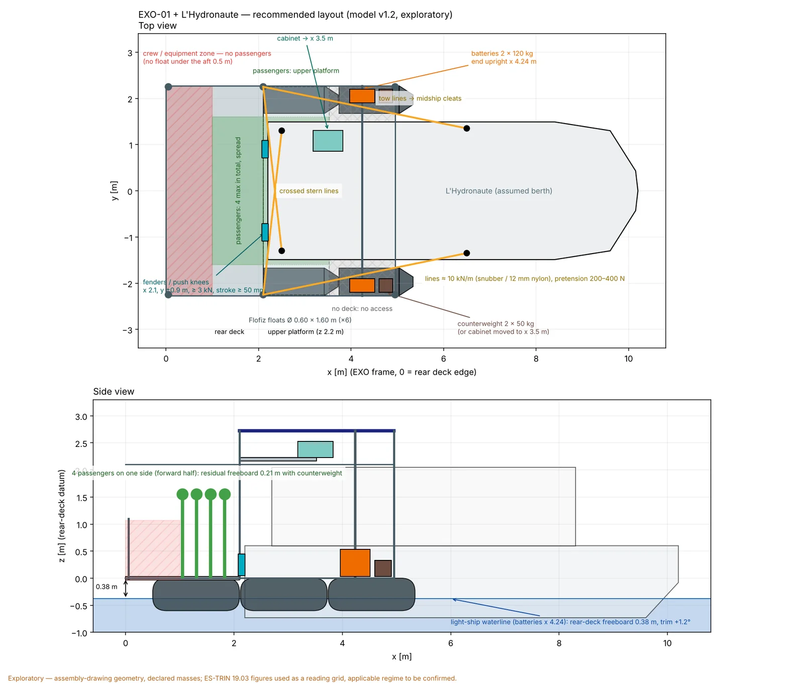

> **Status: exploratory.** Every number below comes from a model built on the assembly drawing and on declared, not measured, masses. They are there to guide the integration and prepare the trials; they are not certified characteristics. Code, configurations and reports are public: [Biutopic/exo01-sim](https://github.com/Biutopic/exo01-sim).

## Why simulate before launching

EXO-01 is a floating exoskeleton: two rows of floats, an aluminium frame, a rear deck, an observation platform, 2 kWp of panels, 240 kg of batteries and two electric pods, which couples to an existing boat — here *L'Hydronaute*. Before the first launch (autumn 2026), three questions drive the integration: **where to put the masses** (batteries, electrical cabinet), **how to tie the boat in** (mooring lines), and **how the whole thing moves** in the chop and boat wakes of the Erdre. A numerical model answers them with orders of magnitude before welding makes them permanent.

*EXO-01 and L'Hydronaute alongside, still water. Render from the simulation tool (assembly-drawing geometry, reconstructed Hydronaute hull).*

## Method

The simulator (`exo01-sim`) is an open Python code with a 3D interface. It chains five calculations, each verifiable on its own:

1. **Geometry and masses.** Six Flofiz floats (Ø 0.60 × 1.60 m, sled nose) in two rows, the frame of the La Mutine assembly drawing (28 May 2026), and a list of 18 masses: structure 290 kg, floats 180 kg, batteries 2 × 120 kg, panels 80 kg, electronics 50 kg, pods 16 kg — **856 kg light**, without payload or people. Every mass carries its provenance (declared / estimated / assumption).
2. **Hydrostatics on the modelled geometry.** Immersed volume and centre of buoyancy integrated on the triangulated float surfaces, then the static equilibrium (draught, trim, heel) solved by Newton's method. Initial stability (GM) the same way. Checked against the analytic cylinder formulas.
3. **Linear hydrodynamics.** Potential-flow theory (boundary element method, [Capytaine 3.0](https://capytaine.github.io/)), 6 degrees of freedom for EXO-01 alone, **12 coupled degrees of freedom** for EXO-01 + L'Hydronaute (hydrodynamic interaction between the two hulls), finite depth 3 m, fresh water. Damping is the potential-flow radiation damping plus an **assumed 5 % of critical** in heave/roll/pitch — no measured damping. The coefficients are precomputed and cached; the interface animates the reconstructed motion in regular waves. A separate time-domain calculation with tension-only lines bounds the linear-line assumption (snatch peaks).
4. **Mooring and propulsion.** Four lines modelled as springs that only work in tension (slack as soon as they unload), 100 N pretension; coupled equilibrium of the two bodies. Quasi-static propulsion: two RDT POD 5.0 pods (bollard thrust 2 × 62 kgf = 1,216 N), ITTC-57 hull resistance + form factors → equilibrium speed and the forces carried by the lines, when pushing (EXO-01 pods) and when towing (the boat's engine).
5. **Design sweeps.** Battery position (44 positions in two zones), line arrangement (36 combinations + presets), each evaluated with the solvers above — the full table is returned, not just a "best" pick.

Verification: 84 automated tests and 31 checks (analytic vs numerical, reference-point transform of the hydrodynamic coefficients exact to 10⁻¹⁵, mesh convergence ≤ 8 % on the coupled case). The assumptions live in an `ASSUMPTIONS.md` versioned with the code.

## What the model says

### 1. Trim: the rear deck carries too much

Light, with the batteries at the rear-deck side rails (the drawing's position), EXO-01 floats **rear deck down by 3.8°**, rear-deck freeboard **0.17 m**, draught 0.37 m. The cause is geometric: the floats' centre of buoyancy is at x ≈ 2.9 m from the stern, the centre of mass at x ≈ 2.3 m.

*Same state, side view: batteries at the rear-deck side rails (top) and moved forward onto the float-top frames (bottom).*

Within the model's assumptions the battery-position sweep is clear: on the rear deck itself the best achievable is −3.3°. **Moved forward onto the float-top side frames, at x ≈ 3.5 m** (between the mid and forward uprights, above the floats, clear of the boat's hull), the 240 kg of batteries cancel the light-ship trim: **0°, freeboard 0.36 m**, and the roll amplitude in beam waves drops from 4.7° to 3.8°. At the end upright (x 4.24 m) the platform trims +1.2° bow-down light but keeps 1.1–1.3° less stern trim in every loaded case — the position retained below.

*Trim (left) and roll/pitch amplitudes (right) against the longitudinal position of both batteries; L'Hydronaute moored, no occupants.*

Necessary, not sufficient. The rear deck stays the weak point under load: two 80 kg people at the rear table bring the trim back to −2.2° even with the batteries forward (−6.9° with the deck edge awash in the drawing's position); four people on the rear deck leave 0.09 m of freeboard (no static equilibrium at all in the drawing's position). The design consequences are listed below.

### 2. In the simulated configurations, freeboard is the constraint

Initial transverse metacentric height ≈ 20 m, longitudinal ≈ 9 m: a 4.5 m wide catamaran on 0.60 m floats is very stiff at small angles. In the simulated configurations, uneven loading and loss of freeboard emerge as the immediate design constraints; capsize limits (large angles, every loading condition) remain outside this study.

### 3. In waves: the response to the selected test case

Natural periods, light: ≈ 1.3–1.5 s (heave 1.4 s, roll 1.3 s, pitch 1.5 s). The selected test case is a regular beam wave of 0.3 m height and 2.5 s period — an order of magnitude for a boat wake, **not a measurement on the Erdre** (the site's wave climate remains to be measured). In that case EXO-01 rolls ≈ 4.3–4.5° for a wave slope of 5.5° — it follows the surface rather than amplifying it — with a vertical deck acceleration ≈ 1.2 m/s² (0.12 g). The moored Hydronaute rolls more (≈ 8°): its hull is narrower. For periods close to the natural periods (1.3–1.6 s) the computed response depends on the assumed damping.

*Regular beam waves H 0.3 m, T 2.5 s: instant of maximum EXO-01 roll (reconstructed linear motion, scale 1:1).*

Important reservation: the real viscous damping is unknown (5 % assumed). Near the resonances of the water trapped between the floats (T ≈ 1.2–1.6 s) the potential-flow coefficients are over-predicted; only a roll decay test will give the real damping.

### 4. Mooring: the four "forward" lines hold a tow, not a push

The drawing's arrangement (four lines from EXO-01's uprights to the boat's forward cleats) balances a **tow** by L'Hydronaute's engine, but not a **push** by EXO-01's pods: the horizontal forces cannot close, and the model only finds an equilibrium by sliding the boat 0.7 m back into the structure. Among 36 arrangements, the highest-ranked under the selected scoring and test conditions is **aft uprights → midship cleats + forward uprights → stern cleats** (two long diagonals), 472 N maximum in a line at full thrust, no slack line at rest. The full mooring study (v1.2, §Layout) qualifies this: lines alone carry the push at the price of 20–45 mm of boat travel into a 60 mm gap; stern fenders add a compression path.

*Top view: the boat is berthed between the two float rows; the space under the frame bays stays free.*

With 100 N of pretension, **every line goes slack each cycle** in 0.3 m waves, with snatch loads estimated at 0.9–1.2 kN: pretension and stiffness (or line dampers) have to be revisited before the trials.

### 5. Propulsion: order of magnitude only

At 100 % of both pods, EXO-01 + L'Hydronaute would reach ≈ 2.8 m/s (10 km/h), with 870 N carried to the boat through the lines. These speeds are **upper bounds**: the model assumes the bollard thrust stays constant with speed, which is false for a propeller; the pods' thrust–speed curve is not known.

## Recommended layout (v1.2): lines, fenders, passenger zones

*Top and side view: stern fenders, crossed and tow lines, crew zone aft, passenger zone, cabinet centred at the forward edge of the rear deck, batteries at the end upright, counterweight. Assembly-drawing geometry, assumed berth.*

The mooring study (121 configurations: 6 arrangements × 4 stiffnesses × 5 pretensions + one rigid case; moored, push 100 %, tow 100 %; three regular waves, linear then time domain) says, within its assumptions:

- **Push goes through compression.** Two fenders / push knees at the rear-deck edge (x 2.1 m, y ±0.9 m, transom height) close the push–tow loop whatever the rope, with 1–20 mm of travel; lines alone (diagonals) do it too, but only at k ≥ 10 kN/m and with 20–45 mm of boat travel into a 60 mm gap. Static load per fender at full thrust: 0.3–0.6 kN.
- **Soft vertically, held sideways.** A rigid coupling (struts) would carry ≈ 1.1–1.3 kN cyclic per strut in 0.3 m waves (the boat would roll 2.3° instead of 9°; the frame takes everything). With lines, heave/pitch/roll of the two hulls stay free; sway and yaw are held by crossed stern lines or diagonals.
- **Compliance rather than "shock absorbers": what the study shows.** The elements are undamped springs; snatch peaks grow with rope stiffness (2 kN/m: 0.5–1.3 kN; 10 kN/m: 0.6–1.5 kN; 50 kN/m: 1.5–3 kN; 200 kN/m: 3–5 kN in the same waves), but very soft lines let the boat gather speed into the fenders (2–5 kN). Direction: lines ≈ 10 kN/m, firm fenders ≈ 50 kN/m, pretension 200–400 N. Choosing an actual damper needs a model with damping, stroke and peak reaction — next step.
- **Indicative sizing**: 12 mm polyester/nylon lines with snubbers (working load 1–1.5 kN, peaks 2–4.5 kN in 0.5 m waves), cleats and uprights ≥ 5 kN, fenders ≥ 3 kN with ≥ 50 mm stroke.

**Passenger zones and capacity (EXO-01 alone, 75 kg per person, ES-TRIN 19.03 reading: heel + wind ≤ 12°, residual freeboard ≥ 0.20 m).** Heel never limits (8 people on one side: 4°; wind 0.25 kN/m² on an assumed 6 m²: 0.7°). The rear-deck freeboard does: each passenger sinks the platform ≈ 15 mm, plus the trim. With the drawing's batteries no passenger meets the criterion; batteries forward, 1–2; with the layout above — **aft of the rear deck closed to passengers (no float under the aft 0.5 m), batteries at the end upright, cabinet on the rear deck, centred and as close to the boat as possible (x 1.75 m), 2 × 75 kg counterweight at x 4.75 m on the side rails** — **4 passengers** anywhere in the allowed zones keep ≥ 0.214 m (6 spread over both decks: 0.245 m); 150 kg of ballast is the weight of two passengers — more aft buoyancy would do better. The price: +3.3° bow-down trim light, and the forward floats become the limit if 4 people crowd one side of the upper platform (0.17 m). Under the 0.30 m minimum freeboard of art. 19.04 no configuration exceeds 1 passenger: the applicable regime (passenger vessel, floating equipment, other) changes the assessment and has to be established with the service instructeur. None of this replaces the weighing, the inclining test and the float survey.

## What the model does not say

- **Masses and positions are declared, not weighed.** The whole trim story rests on the 0.6 m offset between centre of mass and centre of buoyancy.
- **L'Hydronaute's hull is a proxy** (an envelope rebuilt from a partial station table, no survey; at the catalogue waterline it displaces far more than the 2.1–3.0 t of the sources, a known inconsistency); its mass is not measured.
- **Assumed damping (5 %), no wind, no current, no contact** between frame and hull in the linear calculation; massless lines, linear in the frequency-domain calculation and tension-only in the time-domain one.
- **Nothing structural**: the model does not check that the float frames carry 120 kg per battery, nor the loads in the uprights.
- **Nothing on energy**: range and the solar balance are treated separately.

## The five measurements that would change everything

1. The floats' real positions on the chassis (x, axis height, spacing) — all buoyancy and hydrodynamics depend on it.
2. The installed centre of gravity of every component, height above all, and the weighed total mass.
3. Mass accounting: payload, cabling, fluids, deck surface.
4. For the coupling: L'Hydronaute's mass and hull, cleat positions, line material/length/pretension; the pods' thrust–speed curve.
5. Operational loads and environment: occupants, water depth, wave climate, a **decay test** in roll/heave (damping).

## What it changes for EXO-01

- **Move the batteries forward** onto the float-top frames or to the end upright (≈ 520 kg·m forward for 240 kg moved from x 1.43 to 3.60 m), subject to the frame's structural capacity.
- **Rework the mooring**: long diagonals, matched pretension and stiffness, snatch protection.
- **Load the rear deck with care** until the trim is corrected; write occupant positions into the operating instructions.
- **Measure before calibrating**: weighing, float survey and decay test at the first launch, then recalibrate the model.

*Tool: [Biutopic/exo01-sim](https://github.com/Biutopic/exo01-sim) — Python / Capytaine 3.0 / three.js. Full reports: `results/optimisation`, `results/comparison`, `results/verification` in the repository.*
