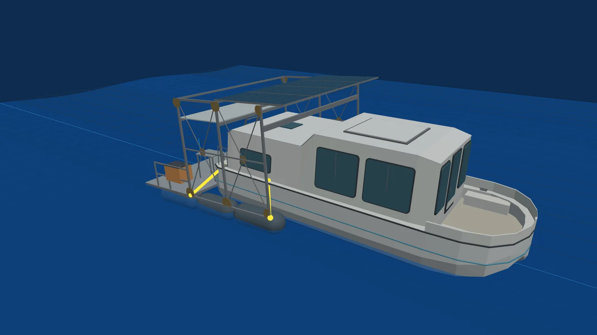
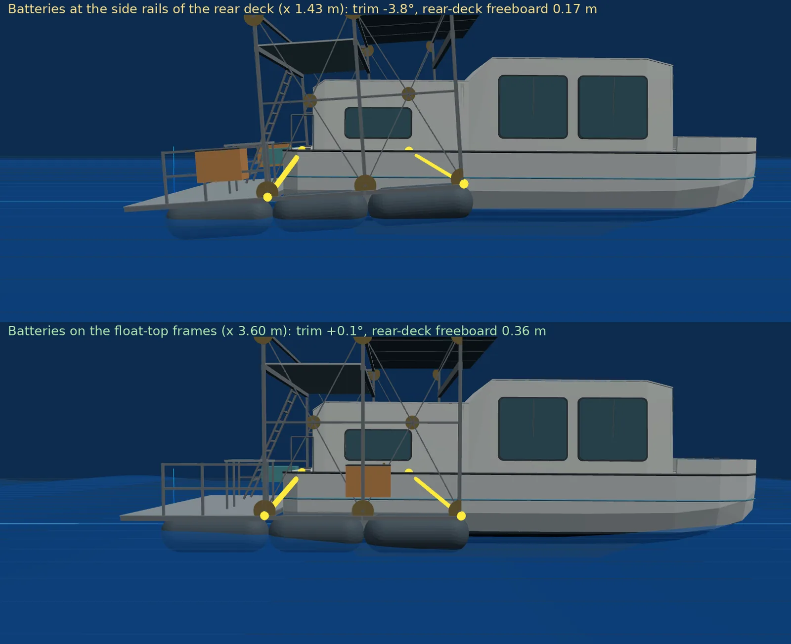
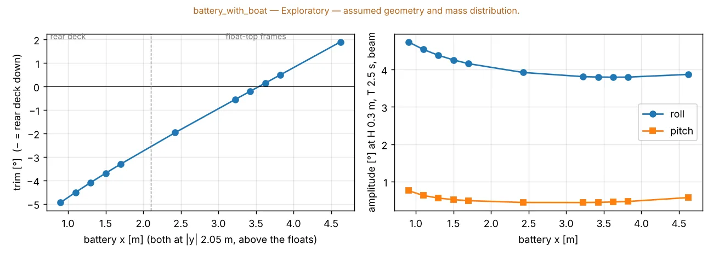
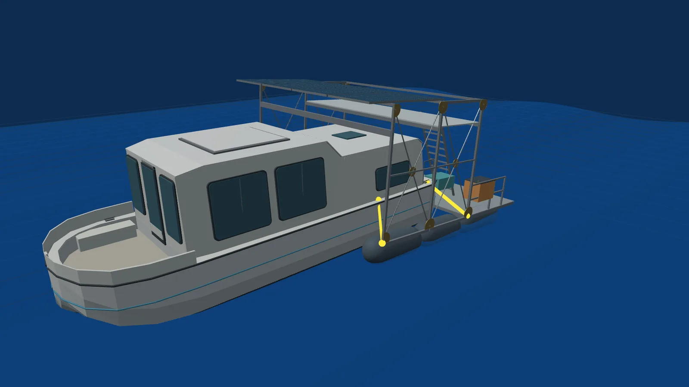
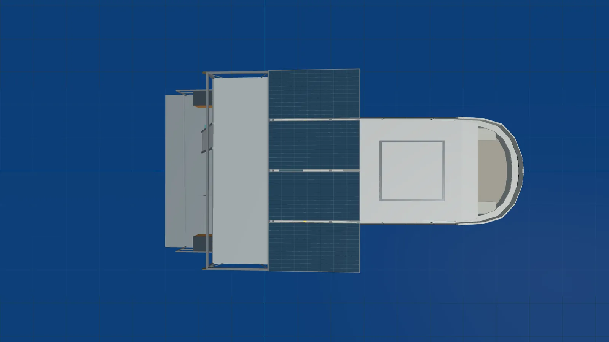
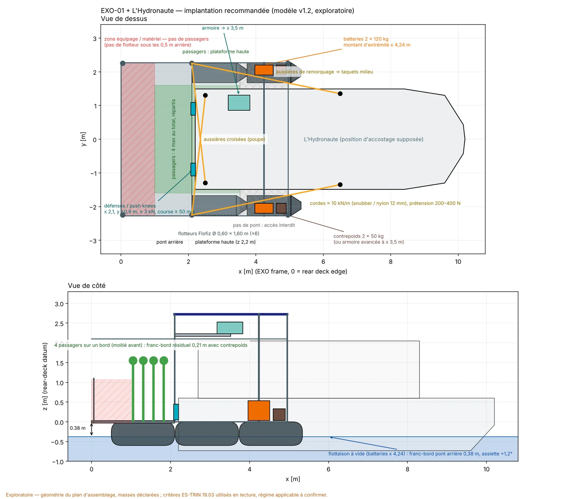

> **Statut : exploratoire.** Tous les chiffres ci-dessous sortent d'un modèle construit sur le plan d'assemblage et sur des masses déclarées, pas mesurées. Ils servent à orienter l'intégration et à préparer les essais ; ils ne sont pas des caractéristiques certifiées. Le code, les configurations et les rapports sont publics : [Biutopic/exo01-sim](https://github.com/Biutopic/exo01-sim).

## Pourquoi simuler avant de mettre à l'eau

EXO-01 est un exosquelette flottant : deux rangées de flotteurs, une structure aluminium, un pont arrière, une plateforme d'observation, 2 kWc de panneaux, 240 kg de batteries et deux propulseurs électriques, qui vient s'accoupler à un bateau existant — ici *L'Hydronaute*. Avant la première mise à l'eau (automne 2026), trois questions conditionnent l'intégration : **où placer les masses** (batteries, armoire électrique), **comment attacher le bateau** (aussières), et **comment l'ensemble bouge** dans le clapot et les sillages de l'Erdre. Un modèle numérique répond à ces questions avec des ordres de grandeur avant que la soudure ne les fige.

*EXO-01 et L'Hydronaute à couple, eau calme. Rendu de l'outil de simulation (géométrie du plan d'assemblage, coque de L'Hydronaute reconstituée).*

## Méthode

Le simulateur (`exo01-sim`) est un code Python ouvert avec une interface 3D. Il enchaîne cinq calculs, chacun vérifiable séparément :

1. **Géométrie et masses.** Six flotteurs Flofiz (Ø 0,60 × 1,60 m, nez traîneau) en deux rangées, la structure du plan d'assemblage La Mutine (28/05/2026), et une liste de 18 masses : structure 290 kg, flotteurs 180 kg, batteries 2 × 120 kg, panneaux 80 kg, électronique 50 kg, propulseurs 16 kg — **856 kg à vide**, hors charge utile et hors occupants. Chaque masse porte sa provenance (déclarée / estimée / hypothèse).
2. **Calcul hydrostatique sur la géométrie modélisée.** Volume immergé et centre de carène intégrés sur les surfaces triangulées des flotteurs, puis équilibre statique (tirant d'eau, assiette, gîte) résolu par Newton. Stabilité initiale (GM) par la même voie. Vérifié contre les formules analytiques des cylindres.
3. **Hydrodynamique linéaire.** Théorie potentielle (méthode des éléments frontières, [Capytaine 3.0](https://capytaine.github.io/)), 6 degrés de liberté pour EXO-01 seul, **12 degrés de liberté couplés** EXO-01 + L'Hydronaute (interaction hydrodynamique entre les deux coques), profondeur finie 3 m, eau douce. L'amortissement est celui du rayonnement (écoulement potentiel) plus **5 % d'amortissement critique supposé** en pilonnement/roulis/tangage — aucun amortissement mesuré. Les coefficients sont pré-calculés et mis en cache ; l'interface anime le mouvement reconstruit en houle régulière. Un calcul séparé en domaine temporel, avec des aussières qui ne travaillent qu'en traction, borne l'hypothèse d'aussières linéaires (pics de reprise).
4. **Amarrage et propulsion.** Quatre aussières modélisées comme des ressorts qui ne travaillent qu'en traction (mou dès qu'elles se détendent), prétension 100 N ; équilibre couplé des deux corps. Propulsion quasi-statique : deux pods RDT POD 5.0 (poussée au point fixe 2 × 62 kgf = 1 216 N), résistance de coque ITTC-57 + facteurs de forme → vitesse d'équilibre et efforts transmis par les aussières, en poussée (pods d'EXO-01) comme en remorquage (moteur du bateau).
5. **Balayages de conception.** Position des batteries (44 positions sur deux zones), arrangement des aussières (36 combinaisons + presets), chacun évalué avec les solveurs ci-dessus — le tableau complet est rendu, pas seulement un « meilleur » choix.

Vérification : 84 tests automatisés et 31 contrôles (analytique vs numérique, transformation du point de référence des coefficients hydrodynamiques exacte à 10⁻¹⁵, convergence du maillage ≤ 8 % sur le cas couplé). Les hypothèses sont tenues dans un fichier `ASSUMPTIONS.md` versionné avec le code.

## Ce que le modèle dit

### 1. L'assiette : le pont arrière est trop chargé

À vide, avec les batteries aux rambardes du pont arrière (position du plan), EXO-01 flotte **pont arrière enfoncé de 3,8°**, franc-bord du pont arrière **0,17 m**, tirant d'eau 0,37 m. La cause est géométrique : le centre de flottabilité des flotteurs est à x ≈ 2,9 m de l'arrière, le centre de masse à x ≈ 2,3 m.

*Même état, vue de côté : batteries aux rambardes du pont arrière (haut) et avancées sur les longerons des flotteurs (bas).*

Dans les hypothèses du modèle, le balayage de position des batteries est net : sur le pont arrière lui-même, le mieux qu'on obtienne est −3,3°. **Avancées sur les longerons des flotteurs, à x ≈ 3,5 m** (entre les montants central et avant, au-dessus des flotteurs, hors de la coque du bateau), les 240 kg de batteries annulent l'assiette à vide : **0°, franc-bord 0,36 m**, et l'amplitude de roulis en houle de travers baisse de 4,7° à 3,8°. Au montant d'extrémité (x 4,24 m) la plateforme pique de +1,2° à vide mais garde 1,1–1,3° d'assiette arrière en moins dans tous les cas chargés — c'est la position retenue plus bas.

*Assiette (gauche) et amplitudes de roulis/tangage (droite) en fonction de la position longitudinale des deux batteries ; L'Hydronaute amarré, pas d'occupants.*

C'est nécessaire, pas suffisant. Le pont arrière reste le point faible sous charge : deux personnes de 80 kg à la table arrière ramènent l'assiette à −2,2° même batteries avancées (−6,9° et pont arrière au ras de l'eau dans la position du plan) ; quatre personnes sur le pont arrière laissent 0,09 m de franc-bord (pas d'équilibre statique du tout dans la position du plan). Les conséquences de conception sont listées plus bas.

### 2. Dans les configurations simulées, c'est le franc-bord qui contraint

Hauteur métacentrique transversale initiale ≈ 20 m, longitudinale ≈ 9 m : un catamaran large de 4,5 m sur des flotteurs de 0,60 m est très raide aux petits angles. Dans les configurations simulées, la répartition inégale des charges et la perte de franc-bord apparaissent comme les contraintes de conception immédiates ; les limites de chavirement (grands angles, toutes conditions de charge) restent hors du périmètre de cette étude.

### 3. En houle : la réponse au cas de test retenu

Périodes propres à vide ≈ 1,3–1,5 s (pilonnement 1,4 s, roulis 1,3 s, tangage 1,5 s). Le cas de test retenu est une houle régulière de travers de 0,3 m de hauteur et 2,5 s de période — un ordre de grandeur de sillage, **pas une mesure sur l'Erdre** (le climat de vagues du site reste à mesurer). Dans ce cas, le roulis d'EXO-01 vaut ≈ 4,3–4,5° pour une pente de vague de 5,5° — la plateforme suit la surface plutôt qu'elle n'amplifie —, l'accélération verticale sur le pont ≈ 1,2 m/s² (0,12 g). L'Hydronaute amarré roule davantage (≈ 8°) : sa coque est plus étroite. Pour des périodes proches des périodes propres (1,3–1,6 s), la réponse calculée dépend de l'amortissement supposé.

*Houle régulière de travers H 0,3 m, T 2,5 s : instant de roulis maximal d'EXO-01 (mouvement linéaire reconstruit, échelle 1:1).*

Réserve importante : l'amortissement visqueux réel n'est pas connu (5 % supposés). Près des résonances de l'eau piégée entre les flotteurs (T ≈ 1,2–1,6 s), les coefficients potentiels sont surestimés ; seul un essai d'extinction en roulis donnera l'amortissement réel.

### 4. Les aussières : les quatre aussières « vers l'avant » tiennent un remorquage, pas une poussée

L'arrangement du plan (quatre aussières des montants d'EXO-01 vers l'avant du bateau) équilibre un **remorquage** par le moteur de L'Hydronaute, mais pas une **poussée** par les pods d'EXO-01 : les efforts horizontaux ne peuvent pas se fermer et le modèle ne trouve d'équilibre qu'en faisant reculer le bateau de 0,7 m dans la structure. Parmi 36 arrangements, l'arrangement le mieux classé selon le score et les conditions de test retenus est **montants arrière → taquets milieu + montants avant → taquets de poupe** (deux diagonales longues), 472 N maximum dans une aussière à pleine poussée, aucune aussière molle au repos. L'étude d'amarrage complète (v1.2, §Implantation) nuance : des aussières seules portent la poussée au prix d'un glissement de 20–45 mm du bateau dans l'espace de 60 mm ; des défenses de poupe apportent un chemin en compression.

*Vue de dessus : le bateau est accosté entre les deux rangées de flotteurs ; l'espace sous les travées reste libre.*

Avec 100 N de prétension, **toutes les aussières se détendent à chaque cycle** en houle de 0,3 m, avec des reprises de tension estimées à 0,9–1,2 kN : prétension et raideur (ou amortisseurs d'aussière) sont à revoir avant les essais.

### 5. Propulsion : ordre de grandeur seulement

À 100 % des deux pods, l'ensemble EXO-01 + L'Hydronaute atteindrait ≈ 2,8 m/s (10 km/h), avec 870 N transmis au bateau par les aussières. Ces vitesses sont des **bornes supérieures** : le modèle suppose la poussée au point fixe constante avec la vitesse, ce qui est faux pour un propulseur à hélice ; la courbe poussée–vitesse des pods n'est pas connue.

## Implantation recommandée (v1.2) : aussières, défenses, zones passagers

*Vue de dessus et de côté : défenses de poupe, aussières croisées et de remorquage, zone équipage à l'arrière, zone passagers, batteries au montant d'extrémité, contrepoids. Géométrie du plan d'assemblage, position d'accostage supposée.*

L'étude d'amarrage (121 configurations : 6 arrangements × 4 raideurs × 5 prétensions + un cas rigide ; amarré, poussée 100 %, remorquage 100 % ; trois houles régulières, calcul linéaire puis domaine temporel) dit, dans ses hypothèses :

- **La poussée passe en compression.** Deux défenses / push knees au bord du pont arrière (x 2,1 m, y ±0,9 m, hauteur du tableau) ferment la boucle poussée–remorquage quelle que soit la corde, avec 1–20 mm de course ; des aussières seules (diagonales) le font aussi, mais seulement à k ≥ 10 kN/m et avec 20–45 mm de glissement du bateau dans un espace de 60 mm. Charge statique par défense à pleine poussée : 0,3–0,6 kN.
- **Souple en vertical, tenu en travers.** Un couplage rigide (bielles) porterait ≈ 1,1–1,3 kN cycliques par bielle dans 0,3 m de houle (le bateau roulerait 2,3° au lieu de 9°, la structure encaisse tout). Avec des aussières, pilonnement/tangage/roulis des deux coques restent libres ; sway et lacet sont tenus par des aussières croisées à la poupe ou des diagonales.
- **Raideur plutôt qu'« amortisseur » : ce que l'étude montre.** Les éléments sont des ressorts sans amortissement ; les pics de reprise croissent avec la raideur de la corde (2 kN/m : 0,5–1,3 kN ; 10 kN/m : 0,6–1,5 kN ; 50 kN/m : 1,5–3 kN ; 200 kN/m : 3–5 kN dans la même houle), mais des cordes très souples laissent le bateau prendre de l'élan contre les défenses (2–5 kN). Direction : cordes ≈ 10 kN/m, défenses fermes ≈ 50 kN/m, prétension 200–400 N. Le choix d'un amortisseur réel demande un modèle avec amortissement, course et réaction maximale — étape suivante.
- **Dimensionnement indicatif** : cordes 12 mm polyester/nylon avec snubbers (charge de travail 1–1,5 kN, pics 2–4,5 kN en 0,5 m de houle), taquets et montants ≥ 5 kN, défenses ≥ 3 kN avec ≥ 50 mm de course.

**Zones passagers et capacité (EXO-01 seul, 75 kg par personne, lecture ES-TRIN 19.03 : gîte + vent ≤ 12°, franc-bord résiduel ≥ 0,20 m).** La gîte n'est jamais limitante (8 personnes sur un bord : 4° ; vent 0,25 kN/m² sur 6 m² supposés : 0,7°). C'est le franc-bord du pont arrière qui limite : chaque passager enfonce la plateforme d'≈ 15 mm, plus l'assiette. Avec les batteries du plan, aucun passager ne satisfait le critère ; batteries avancées, 1–2 ; avec l'implantation ci-dessus — **arrière du pont fermé aux passagers (pas de flotteur sous les 0,5 m arrière), batteries au montant d'extrémité, armoire avancée à x 3,5 m, contrepoids 2 × 50 kg à x 4,75 m** — **4 passagers** n'importe où dans les zones autorisées gardent ≥ 0,216 m (6 répartis sur les deux ponts : 0,246 m). Contrepartie : +3,3° de piqué à vide et les flotteurs avant deviennent la limite si 4 personnes se mettent d'un même bord sur la plateforme haute (0,17 m). Sous le franc-bord minimal de 0,30 m de l'art. 19.04, aucune configuration ne dépasse 1 passager : le régime applicable (bateau à passagers, engin flottant, autre) change l'évaluation et reste à établir avec le service instructeur. Rien de tout cela ne remplace la pesée, l'essai de stabilité et le relevé des flotteurs.

## Ce que le modèle ne dit pas

- **Les masses et leurs positions sont déclarées, pas pesées.** Toute l'assiette repose sur le décalage de 0,6 m entre centre de masse et centre de flottabilité.
- **La coque de L'Hydronaute est une coque de substitution** (enveloppe reconstruite à partir d'une table de couples partielle, sans relevé ; à la flottaison du catalogue elle déplace bien plus que les 2,1–3,0 t des sources, incohérence connue) ; sa masse n'est pas mesurée.
- **Amortissement supposé (5 %), pas de vent, pas de courant, pas de contact** structure–coque dans le calcul linéaire ; aussières sans masse, linéaires dans le calcul fréquentiel et en traction seule dans le calcul temporel.
- **Rien sur la structure** : le modèle ne vérifie pas que les longerons des flotteurs portent 120 kg par batterie, ni les efforts dans les montants.
- **Rien sur l'énergie** : autonomie et bilan solaire sont traités séparément.

## Les cinq mesures qui changeraient tout

1. Position réelle des flotteurs sur le châssis (x, hauteur d'axe, écartement) — toute la flottabilité et l'hydrodynamique en dépendent.
2. Centre de gravité installé de chaque composant, surtout en hauteur, et masse totale pesée.
3. Comptabilité des masses : charge utile, câblage, fluides, surface de pont.
4. Pour l'accouplement : masse et coque de L'Hydronaute, position des taquets, matériau/longueur/prétension des aussières ; courbe poussée–vitesse des pods.
5. Charges opérationnelles et environnement : occupants, profondeur d'eau, climat de houle, **essai d'extinction** en roulis/pilonnement (amortissement).

## Ce que cela change pour EXO-01

- **Avancer les batteries** sur les longerons des flotteurs ou au montant d'extrémité (≈ 520 kg·m vers l'avant pour 240 kg déplacés de x 1,43 à 3,60 m), sous réserve de la tenue structurelle du cadre.
- **Revoir l'amarrage** : diagonales longues, prétension et raideur adaptées, protection contre les à-coups.
- **Charger le pont arrière avec mesure** tant que l'assiette n'a pas été corrigée ; prévoir la position des occupants dans les consignes d'exploitation.
- **Mesurer avant de calibrer** : pesée, relevé des flotteurs et essai d'extinction à la première mise à l'eau, puis recalage du modèle.

*Outil : [Biutopic/exo01-sim](https://github.com/Biutopic/exo01-sim) — Python / Capytaine 3.0 / three.js. Rapports complets : `results/optimisation`, `results/comparison`, `results/verification` dans le dépôt.*
