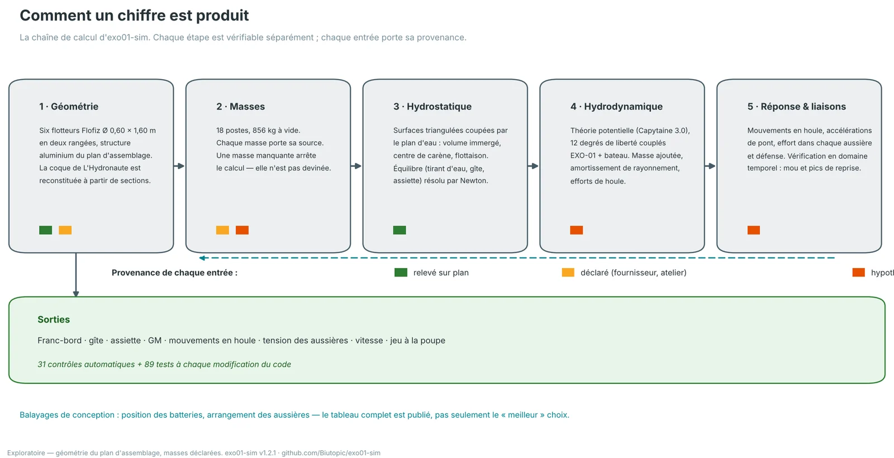
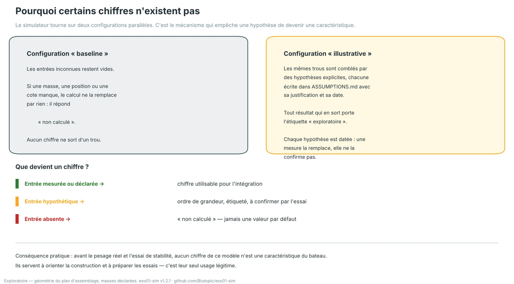
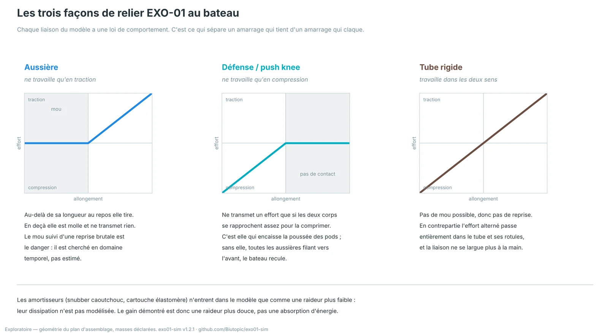
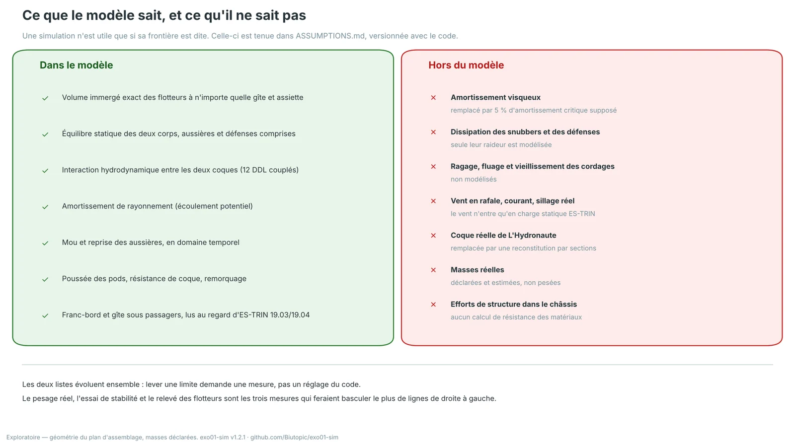
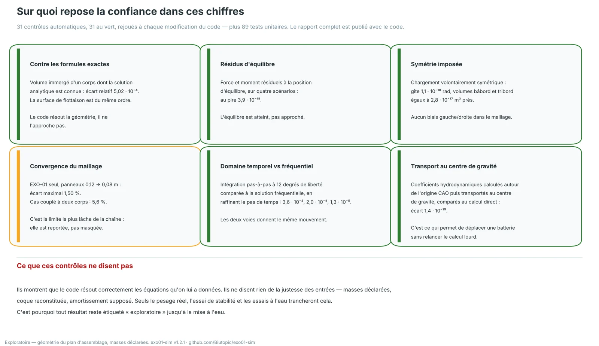

> **Statut : exploratoire.** Cette page décrit une méthode, pas un résultat. Les chiffres qu'elle cite servent à montrer comment ils sont produits et vérifiés. Le code, les configurations, les hypothèses et les rapports de vérification sont publics : [Biutopic/exo01-sim](https://github.com/Biutopic/exo01-sim).

Nous publions des chiffres sur une plateforme qui n'a jamais touché l'eau. C'est une position inconfortable, et la seule façon honnête de la tenir est de dire comment ces chiffres sont faits, ce qui les soutient, et à partir d'où ils ne valent plus rien. Cette page est cette déclaration.

## 1. La chaîne de calcul

*La chaîne de calcul d'exo01-sim. Cinq étapes, chacune vérifiable séparément ; chaque entrée porte sa provenance.*

Le simulateur est un code Python ouvert avec une interface 3D. Il enchaîne cinq calculs. Aucun n'est une boîte noire : chacun peut être rejoué seul et comparé à une référence.

La **géométrie** vient du plan d'assemblage — six flotteurs Flofiz Ø 0,60 × 1,60 m en deux rangées, structure aluminium. La coque de *L'Hydronaute* n'est pas relevée : elle est reconstituée à partir d'une table de sections, et c'est une limite assumée, pas un détail.

Les **masses** sont dix-huit postes, 856 kg à vide, chacun étiqueté par sa source. Une masse manquante n'est pas remplacée par une moyenne : le calcul s'arrête et le dit.

L'**hydrostatique** travaille sur les surfaces triangulées réelles coupées par le plan d'eau. Volume immergé, centre de carène et flottaison sont intégrés exactement, à n'importe quelle gîte et assiette — pas interpolés dans une table.

L'**hydrodynamique** est de la théorie potentielle (Capytaine 3.0), à douze degrés de liberté couplés EXO-01 + bateau, c'est-à-dire avec l'interaction entre les deux coques et non deux calculs séparés mis côte à côte.

La **réponse et les liaisons** donnent les mouvements en houle, les accélérations de pont et l'effort dans chaque aussière et chaque défense — doublés d'un calcul pas-à-pas en temps, parce que c'est là, et seulement là, qu'apparaissent le mou et les pics de reprise.

## 2. Pourquoi certains chiffres n'existent pas

*Le simulateur tourne sur deux configurations parallèles. C'est le mécanisme qui empêche une hypothèse de devenir une caractéristique.*

Un simulateur donne toujours un nombre. C'est son défaut principal : il ne sait pas se taire. Nous avons donc construit le silence dans l'outil.

La configuration **baseline** laisse les entrées inconnues vides. Si une masse, une position ou une cote manque, le calcul ne la remplace par rien et répond « non calculé ». La configuration **illustrative** comble les mêmes trous par des hypothèses explicites, chacune écrite dans `ASSUMPTIONS.md` avec sa justification et sa date — et tout ce qui en sort porte l'étiquette « exploratoire ».

Conséquence pratique, et elle est entière : **avant le pesage réel et l'essai de stabilité, aucun chiffre de ce modèle n'est une caractéristique d'EXO-01.** Ils orientent la construction et préparent les essais. C'est leur seul usage légitime, et c'est déjà beaucoup : ils ont déplacé des batteries et changé un plan d'amarrage avant que la soudure ne les fige.

## 3. Les liaisons : ce qui sépare un amarrage qui tient d'un amarrage qui claque

*Chaque liaison du modèle a une loi de comportement. Une aussière ne tire ; une défense ne pousse ; un tube fait les deux.*

Modéliser une aussière comme un ressort linéaire est commode et faux dans le cas qui compte. Une aussière ne travaille qu'en traction : en deçà de sa longueur au repos elle est molle et ne transmet rien. Le mou suivi d'une reprise brutale est précisément le mode de rupture d'un amarrage, et un modèle linéaire ne le voit jamais.

Les trois types de liaison du modèle — aussière, défense, tube rigide — sont donc traités avec leur vraie loi, dans le calcul statique comme dans le calcul temporel. C'est ce qui a permis de montrer, par exemple, qu'un arrangement d'aussières toutes filantes vers l'avant ne peut pas encaisser la poussée des propulseurs : le bateau recule de 300 à 370 mm et toutes les aussières se détendent. Avec deux défenses à la poupe, le même arrangement tient.

Une précision qui compte : les amortisseurs (snubber caoutchouc, cartouche élastomère) n'entrent dans le modèle que comme une **raideur plus faible**. Leur dissipation n'est pas modélisée. Le gain démontré est donc une raideur plus douce, pas une absorption d'énergie — et nous ne prétendons pas l'inverse.

## 4. La frontière du modèle

*Une simulation n'est utile que si sa frontière est dite. Celle-ci est tenue dans `ASSUMPTIONS.md`, versionnée avec le code.*

Ce qui est hors du modèle n'est pas une liste de regrets, c'est la liste de ce qu'il faudra mesurer. L'amortissement visqueux est remplacé par 5 % d'amortissement critique supposé. Le ragage, le fluage et le vieillissement des cordages ne sont pas modélisés. Le vent n'entre qu'en charge statique ES-TRIN, pas en rafale. La coque du bateau est une reconstitution. Les masses sont déclarées, pas pesées. Et aucun calcul de résistance des matériaux n'est fait sur le châssis.

Les deux colonnes évoluent ensemble : **lever une limite demande une mesure, pas un réglage du code.** Trois mesures feraient basculer le plus de lignes de droite à gauche — le pesage réel, l'essai de stabilité, et un relevé des flotteurs.

## 5. Sur quoi repose la confiance

*31 contrôles automatiques, tous au vert, rejoués à chaque modification du code — plus 89 tests unitaires.*

La vérification ne se raconte pas, elle se rejoue. Le volume immergé est comparé à des corps dont la solution analytique est connue. Les résidus d'équilibre sont au pire de l'ordre de 10⁻¹⁵. Un chargement volontairement symétrique donne une gîte nulle à 10⁻¹⁸ rad près, ce qui exclut un biais gauche/droite dans le maillage. Le calcul pas-à-pas en temps et la solution fréquentielle convergent l'un vers l'autre quand on raffine le pas. La convergence du maillage hydrodynamique est la limite la plus lâche de la chaîne — 1,5 % pour EXO-01 seul, 5,6 % pour le cas couplé — et elle est reportée, pas masquée.

Et surtout, ce que ces contrôles **ne** disent **pas** : ils montrent que le code résout correctement les équations qu'on lui a données. Ils ne disent rien de la justesse des entrées. Un code parfait nourri de masses fausses produit des chiffres faux avec une grande élégance. Seuls le pesage réel et les essais à l'eau trancheront cela — et c'est pourquoi l'étiquette « exploratoire » reste collée à chaque résultat jusqu'à la mise à l'eau.

## Lire plus loin

Le code, les configurations, les hypothèses (`ASSUMPTIONS.md`), l'audit des packages de référence (`AUDIT.md`), l'étude d'amarrage (`docs/MOORING.md`) et le rapport de vérification complet sont publics sur [github.com/Biutopic/exo01-sim](https://github.com/Biutopic/exo01-sim). Le dépôt contient aussi deux cartes interactives du code lui-même, pour qui veut vérifier que l'outil fait ce que cette page dit qu'il fait.
