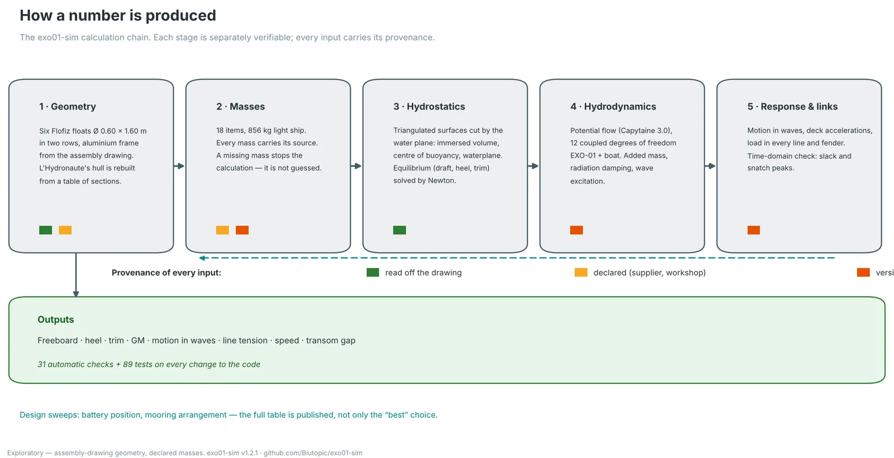
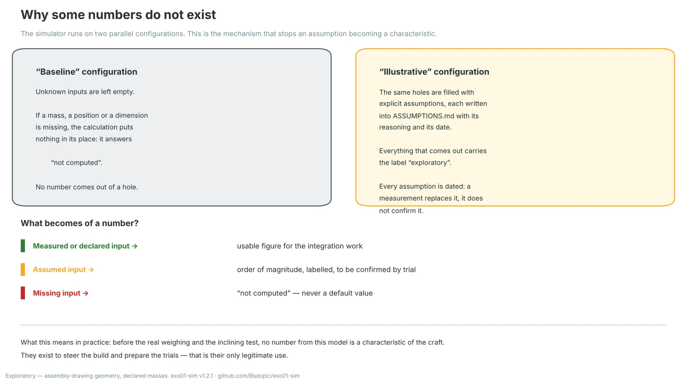
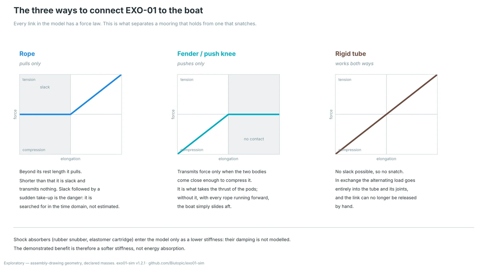
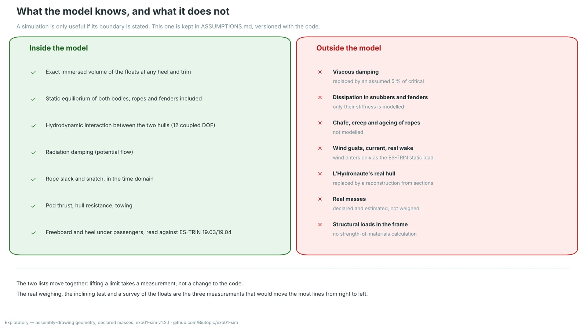
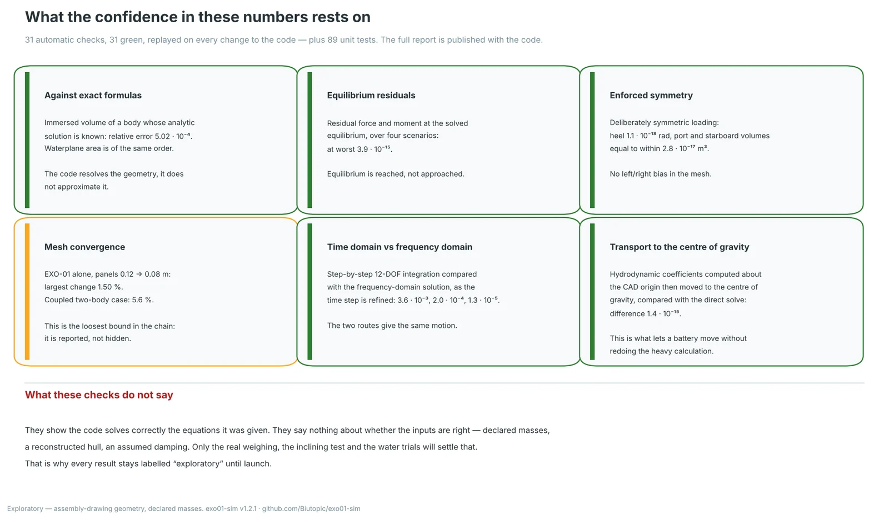

> **Status: exploratory.** This page describes a method, not a result. The figures it quotes are there to show how figures are produced and checked. The code, the configurations, the assumptions and the verification reports are public: [Biutopic/exo01-sim](https://github.com/Biutopic/exo01-sim).

We publish numbers about a platform that has never touched the water. That is an uncomfortable position, and the only honest way to hold it is to say how those numbers are made, what holds them up, and where they stop being worth anything. This page is that statement.

## 1. The calculation chain

*The exo01-sim calculation chain. Five stages, each separately verifiable; every input carries its provenance.*

The simulator is open Python with a 3D interface. It chains five calculations. None is a black box: each can be replayed alone and compared against a reference.

The **geometry** comes from the assembly drawing — six Flofiz floats Ø 0.60 × 1.60 m in two rows, aluminium frame. *L'Hydronaute*'s hull is not surveyed: it is rebuilt from a table of sections, and that is an acknowledged limit, not a detail.

The **masses** are eighteen items, 856 kg light ship, each labelled with its source. A missing mass is not replaced by an average: the calculation stops and says so.

The **hydrostatics** work on the real triangulated surfaces cut by the water plane. Immersed volume, centre of buoyancy and waterplane are integrated exactly, at any heel and trim — not interpolated from a table.

The **hydrodynamics** are potential flow (Capytaine 3.0), at twelve coupled degrees of freedom EXO-01 + boat, meaning with the interaction between the two hulls rather than two separate calculations placed side by side.

The **response and links** give motion in waves, deck accelerations and the load in every rope and fender — doubled by a step-by-step calculation in time, because that is where, and only where, slack and snatch peaks appear.

## 2. Why some numbers do not exist

*The simulator runs on two parallel configurations. This is the mechanism that stops an assumption becoming a characteristic.*

A simulator always gives a number. That is its main flaw: it does not know how to stay silent. So we built the silence into the tool.

The **baseline** configuration leaves unknown inputs empty. If a mass, a position or a dimension is missing, the calculation puts nothing in its place and answers "not computed". The **illustrative** configuration fills the same holes with explicit assumptions, each written into `ASSUMPTIONS.md` with its reasoning and its date — and everything that comes out carries the label "exploratory".

What this means in practice, and it means it entirely: **before the real weighing and the inclining test, no number from this model is a characteristic of EXO-01.** They steer the build and prepare the trials. That is their only legitimate use, and it is already a great deal: they have moved batteries and changed a mooring plan before the welding froze either in place.

## 3. The links: what separates a mooring that holds from one that snatches

*Every link in the model has a force law. A rope only pulls; a fender only pushes; a tube does both.*

Modelling a rope as a linear spring is convenient and wrong in the case that matters. A rope works in tension only: shorter than its rest length it is slack and transmits nothing. Slack followed by a sudden take-up is precisely how a mooring fails, and a linear model never sees it.

The model's three link types — rope, fender, rigid tube — are therefore handled with their real law, in the static calculation and in the time-domain one alike. That is what made it possible to show, for example, that an arrangement with every rope running forward cannot take the thrust of the pods: the boat slides 300 to 370 mm aft and every rope goes slack. With two fenders at the stern, the same arrangement holds.

One qualification that matters: shock absorbers (rubber snubbers, elastomer cartridges) enter the model only as a **lower stiffness**. Their dissipation is not modelled. The demonstrated benefit is therefore a softer stiffness, not energy absorption — and we do not claim otherwise.

## 4. The boundary of the model

*A simulation is only useful if its boundary is stated. This one is kept in `ASSUMPTIONS.md`, versioned with the code.*

What sits outside the model is not a list of regrets, it is the list of what will have to be measured. Viscous damping is replaced by an assumed 5 % of critical. Chafe, creep and ageing of ropes are not modelled. Wind enters only as the ES-TRIN static load, never as a gust. The boat's hull is a reconstruction. The masses are declared, not weighed. And no strength-of-materials calculation is done on the frame.

The two columns move together: **lifting a limit takes a measurement, not a change to the code.** Three measurements would move the most lines from right to left — the real weighing, the inclining test, and a survey of the floats.

## 5. What the confidence rests on

*31 automatic checks, all green, replayed on every change to the code — plus 89 unit tests.*

Verification is not something you narrate, it is something you replay. Immersed volume is compared against bodies whose analytic solution is known. Equilibrium residuals are at worst of the order of 10⁻¹⁵. A deliberately symmetric loading gives zero heel to within 10⁻¹⁸ rad, which rules out a left/right bias in the mesh. The step-by-step time calculation and the frequency-domain solution converge on each other as the time step is refined. Hydrodynamic mesh convergence is the loosest bound in the chain — 1.5 % for EXO-01 alone, 5.6 % for the coupled case — and it is reported, not hidden.

And above all, what these checks do **not** say: they show the code solves correctly the equations it was given. They say nothing about whether the inputs are right. A perfect code fed wrong masses produces wrong numbers with great elegance. Only the real weighing and the water trials will settle that — which is why the "exploratory" label stays attached to every result until launch.

## Reading further

The code, the configurations, the assumptions (`ASSUMPTIONS.md`), the audit of the reference packages (`AUDIT.md`), the mooring study (`docs/MOORING.md`) and the full verification report are public at [github.com/Biutopic/exo01-sim](https://github.com/Biutopic/exo01-sim). The repository also holds two interactive maps of the code itself, for anyone who wants to check that the tool does what this page says it does.
